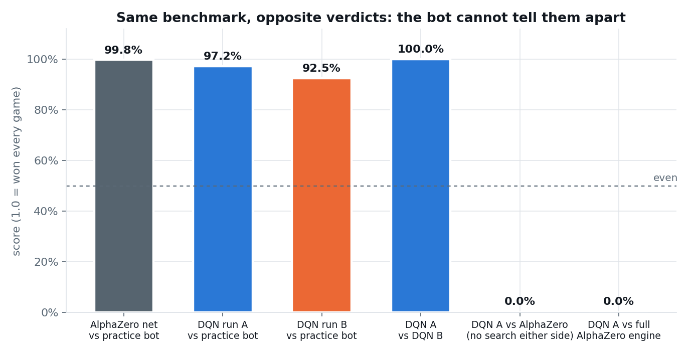
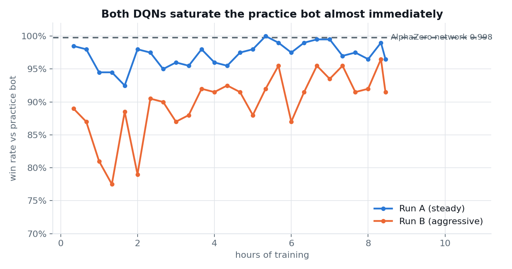

# Dots & Boxes: AlphaZero vs DQN

Two reinforcement learning agents for 5×5 Dots & Boxes (25 boxes, 60 lines), written from
scratch with no RL library, and measured against each other on the same board with the same
input features.

The result that made this worth writing up: **AlphaZero's network beat the DQN 200–0 with tree
search turned off on both sides.** Not 200–0 because one of them got to think ahead and the
other didn't — both were reduced to a single forward pass per move. The gap is in the learned
network, not the search on top of it.



## Results

| Matchup | Games | W–D–L | Score | Avg margin |
|---|---:|:---:|---:|---:|
| AlphaZero network vs benchmark bot | 400 | 399–0–1 | 99.8% | +12.41 |
| DQN run A vs benchmark bot | 400 | 389–0–11 | 97.3% | +10.48 |
| DQN run B vs benchmark bot | 400 | 370–0–30 | 92.5% | +10.04 |
| DQN run A vs DQN run B | 200 | 200–0–0 | 100.0% | +17.00 |
| **DQN run A vs AlphaZero, no search either side** | **200** | **0–0–200** | **0.0%** | **−9.00** |
| DQN run A vs full AlphaZero engine | 24 | 0–0–24 | 0.0% | −10.00 |

Raw numbers in [`results/eval_results.json`](results/eval_results.json). Full write-up with
method and every hyperparameter in [`docs/DQN_Dots_and_Boxes_Report.pdf`](docs/DQN_Dots_and_Boxes_Report.pdf).

Three things in that table are worth more than the headline.

**The benchmark bot is useless past a point.** AlphaZero scores 99.8% against it and the DQN
scores 97.3% — a gap that looks like measurement noise. Put the two on a board together and
it's 200–0. Any conclusion drawn from bot scores alone would have been wrong, and the DQN
reached 98.5% against that bot inside the first twenty minutes of an eight-hour run. The curve
below is flat for the remaining seven and a half hours, and that is a property of the test, not
of the agent.



**Two configurations were worth the trouble.** Run A and run B differ only in learning rate,
n-step length, exploration decay, target sync period and replay ratio. Against the bot they
look similar (97.3% vs 92.5%). Head to head, run A won 200 of 200 by an average of seventeen
boxes. Running a single configuration would have left a coin-flip chance of keeping the much
weaker model without ever knowing.

**Volume isn't the bottleneck.** The DQN played 2,047,872 games in 8.4 hours. The AlphaZero
model it lost to had 397,094 games across 19.5 hours — the DQN passed that total inside the
first ninety minutes and still lost every game.

## What's in here

```
alphazero/   the AlphaZero engine: network + PUCT tree search + exact alpha-beta
             endgame solver with chain/loop theory. One file, ~2,800 lines.
dqn/         the DQN: board, dueling network, n-step replay, training loop, self-tests.
gui/         a Tk window to play either engine by hand, or watch them play each other.
models/      four trained checkpoints (5×5 and 6×6 AlphaZero, two DQN runs).
notebooks/   the Kaggle notebook that ran the DQN training.
results/     evaluation output and the full training history behind the figures.
docs/        the PDF report and the figures.
```

## Running it

```bash
pip install -r requirements.txt

python dqn/selftest.py                          # five correctness checks, ~20 s
python gui/dab_gui.py                           # play, or watch the two engines fight

python dqn/train_dqn.py --board 5 --out runs/dqn --hours 8.5 \
    --games 384 --lr 3e-4 --nstep 3 --eps-decay-steps 4000000

python alphazero/nightmare_dab.py test          # the AlphaZero test suite
python alphazero/nightmare_dab.py play --board 5 --model models/best_5x5.pt
```

The GUI has an opponent picker and a watch mode where the two engines play each other move by
move. That is the quickest way to see the difference: the DQN answers instantly and holds its
own through the opening, then loses the board in the chain endgame.

## How the two agents work

**AlphaZero.** A residual convolutional network with policy and value heads guides a PUCT tree
search. When 24 or fewer lines remain, or the board becomes nothing but chains and loops, an
exact alpha-beta solver takes over — with a score-independent transposition table, dominance
pruning, and the standard loony-endgame chain theory (a chain of n ≥ 3 is worth −(n−2+|V′+2|),
a loop of n ≥ 4 is worth −(n−4+|V′+4|)). About 40% of training targets come back as proven
values rather than estimates, which is most of why the endgame is unbeatable.

**DQN.** Dueling Double DQN with n-step returns, trained by self-play. Q(s,a) is the expected
remaining margin for the player to move, divided by the box count so it lives in [−1, 1].

Two details in the DQN are specific to this game and easy to get silently wrong:

*Completing a box gives you another turn*, so the player does not alternate reliably. A normal
n-step return assumes it does and flips signs on a schedule. This implementation walks the real
trajectory and flips only on moves that failed to capture. Each stored transition carries its
own sign saying whether the bootstrap state belongs to the same player or the opponent. Get it
backwards and the loss still falls while the agent learns the opposite of what it should, which
is why there's a unit test that walks a four-move sequence by hand.

*The reward is paid per move rather than at the end.* Each move earns (boxes captured) / 25
immediately. Summed over a game with the turn-change signs applied, that telescopes to exactly
the final margin / 25 — it's the same quantity paid earlier, not a heuristic. A test asserts
this on random games before every training run, so the shaping can't silently introduce bias.

Both agents get the same 20 input planes, including chain and loop structure with the parity of
the long-chain count. A small convolutional network cannot count connected components on its
own, so that information is computed with a BFS and handed to it directly. The DQN was not
handicapped on features.

## What this does and doesn't show

It shows the DQN implementation is correct and competent. It learned a genuinely hard game from
nothing but self-play and the final score, to the point of beating a reasonable opponent 97% of
the time, with every correctness test passing.

It shows the gap between the two is not about search. That's the finding. It would have been
easy to assume the DQN loses because AlphaZero gets to think ahead — but with thinking removed
from both sides the wipeout was total.

It does not show the DQN could never get there. Eight hours is one night, on two T4s.
Prioritised replay, distributional Q-learning, a wider network and a properly sized exploration
schedule are all untried. The fair claim is narrow: given one night each, AlphaZero wins
overwhelmingly.

And it does not transfer to problems without a simulator. The reason AlphaZero wins here is that
Dots & Boxes can be simulated perfectly and for free, so search-based policy improvement costs
nothing. Where the dynamics are approximate — most robotics and control — that advantage
disappears and the model-free methods are the right tool.

## A mistake worth recording

Both training runs burned through their exploration schedule far faster than intended, because
the GPUs turned out quicker than the throughput estimate the schedule was sized against. Run B
hit its 5% epsilon floor after nine minutes, run A after about twenty, so both spent roughly 97%
of the night at minimum exploration. I noticed while the run was live and chose not to restart,
since that would have cost the remaining GPU quota for the week. If you repeat this, set the
decay from measured throughput or in wall-clock hours, not in environment steps.

## Board size note

The DQN was trained on 5×5 only. AlphaZero has checkpoints for both 5×5 and 6×6. The GUI falls
back to AlphaZero if you ask for the DQN on a 6×6 board rather than serving a model that was
never trained there.

## License

MIT. See [LICENSE](LICENSE).
